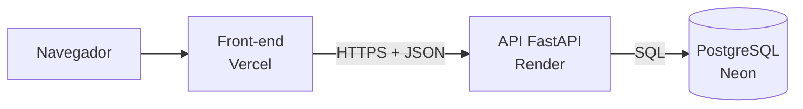

# Sistema de Chamados de Manutenção

API back-end (com banco SQL) para abrir, atribuir e acompanhar **chamados de manutenção** e as **tarefas** de atendimento, em ambientes compartilhados como condomínios e escolas. Projeto da **Residência em TIC 47 – Conecta e Capacita** (Programa Bolsa Futuro Digital – BFD – Ciclo II – RS), desafio *Desenvolvimento de Aplicação Back-End para Gestão de Tarefas*.

> **Status:** em desenvolvimento. A documentação e os protótipos já estão em [`docs/`](docs/). O código da API e do front entram nas próximas sprints.

## O que o sistema faz

- Solicitantes abrem chamados (local, descrição, prioridade).
- Técnicos assumem o chamado, criam tarefas e atualizam o andamento.
- Regras de status: `aberto → em atendimento → concluído` (ou `cancelado`). O chamado só conclui quando todas as tarefas estão concluídas.
- Consultas com filtros por status, prioridade e local, e relatórios em SQL.

## Stack

| Camada | Tecnologia | Hospedagem (plano gratuito) |
|---|---|---|
| Front-end | React + Vite | **Vercel** |
| API | Python 3.12, FastAPI, Uvicorn | **Render** (serviço web) |
| Validação | Pydantic v2 | – |
| Acesso a dados | SQLAlchemy 2.0 | – |
| Banco de dados | PostgreSQL 16 (SQLite em memória nos testes) | **Neon** |
| Testes | pytest e HTTPX; Postman para testes manuais | – |
| Documentação da API | Swagger UI e ReDoc (gerados pelo FastAPI, em `/docs` e `/redoc`) | junto da API |
| Versionamento | Git e GitHub | GitHub |
| Gestão | Trello (Kanban) | – |

### Arquitetura



## Estrutura do repositório

Estrutura **prevista** (as pastas de código serão criadas ao longo das sprints):

```text
.
├── docs/            # briefing, relatório final, wireframes e diagramas (já existe)
├── app/             # API FastAPI: main.py, database.py, models/, schemas/, routers/, services/
├── tests/           # testes com pytest
├── frontend/        # front-end publicado na Vercel
├── requirements.txt
└── README.md
```

## Documentação

| Arquivo | Conteúdo |
|---|---|
| [`docs/Briefing - Sistema de Chamados de Manutencao.docx`](docs/Briefing%20-%20Sistema%20de%20Chamados%20de%20Manutencao.docx) | Descrição inicial da ideia e escopo do MVP |
| [`docs/Relatorio Final - Sistema de Chamados de Manutencao.docx`](docs/Relatorio%20Final%20-%20Sistema%20de%20Chamados%20de%20Manutencao.docx) | Relatório técnico, preenchido ao longo das sprints |
| [`docs/Wireframe UI - Sistema de Chamados.png`](docs/Wireframe%20UI%20-%20Sistema%20de%20Chamados.png) | Wireframes das 4 telas |
| [`docs/Whiteboard UI - Sistema de Chamados.png`](docs/Whiteboard%20UI%20-%20Sistema%20de%20Chamados.png) | Esboço do fluxo entre as telas |
| [`docs/Diagrama de Casos de Uso - Sistema de Chamados.png`](docs/Diagrama%20de%20Casos%20de%20Uso%20-%20Sistema%20de%20Chamados.png) | Diagrama de casos de uso |

## Endpoints previstos

| Método | Rota | Descrição |
|---|---|---|
| POST | `/chamados` | Abrir um chamado |
| GET | `/chamados` | Listar com filtros (`status`, `prioridade`, `local`) |
| GET | `/chamados/{id}` | Consultar um chamado |
| PATCH | `/chamados/{id}` | Alterar dados e status |
| DELETE | `/chamados/{id}` | Cancelar (exclusão lógica) |
| POST / GET | `/chamados/{id}/tarefas` | Criar e listar tarefas de um chamado |
| GET | `/tarefas` | Listar tarefas por responsável e status |
| PATCH | `/tarefas/{id}` | Alterar dados e status da tarefa |
| POST / GET | `/locais` e `/usuarios` | Cadastrar e consultar |
| GET | `/relatorios/...` | Relatórios em SQL (ex.: chamados por status, tarefas atrasadas) |

## Como executar localmente

> Os comandos abaixo valem a partir da criação do código da API. Ajuste os nomes se a estrutura mudar.

```bash
python -m venv .venv
```

```bash
pip install -r requirements.txt
```

```bash
uvicorn app.main:app --reload
```

A documentação interativa fica em `http://localhost:8000/docs`.

### Variáveis de ambiente

| Variável | Onde | Para quê |
|---|---|---|
| `DATABASE_URL` | API | String de conexão do PostgreSQL (Neon, com `sslmode=require`) |
| `ALLOWED_ORIGINS` | API | Endereços do front liberados no CORS, separados por vírgula |
| `API_URL` | Front | Endereço da API publicada no Render |

Não versione arquivos `.env` nem senhas.

## Deploy (tudo gratuito)

Ordem recomendada: **banco → API → front**.

1. **Banco (Neon):** crie o projeto, copie a string de conexão e guarde em `DATABASE_URL`.
2. **API (Render):** crie um *Web Service* ligado a este repositório.
   - Build: `pip install -r requirements.txt`
   - Start: `uvicorn app.main:app --host 0.0.0.0 --port $PORT`
   - Variáveis: `DATABASE_URL` e `ALLOWED_ORIGINS` (o endereço do front na Vercel).
3. **Front (Vercel):** importe este repositório, defina **Root Directory** como `frontend` e configure o endereço da API (`API_URL`).
4. **CORS:** depois de publicar o front, coloque o endereço dele em `ALLOWED_ORIGINS` na API.

Cuidados com os planos gratuitos:

- A API no Render dorme após cerca de 15 minutos sem uso e a primeira chamada pode levar de 30 a 60 segundos. Abra `/docs` alguns minutos antes de uma apresentação.
- Os limites dos planos mudam com frequência. Confira as páginas oficiais da Vercel, do Render e do Neon antes de depender deles.

## Cronograma

Residência de 22/09/2026 a 22/12/2026, em seis sprints: estudo de SQL e APIs (S1–S2), API com Create/Read (S3), Update/Delete e regras de negócio (S4), testes e documentação (S5) e finalização (S6).

## Equipe

- [Nome do residente 1]
- [Nome do residente 2]

Orientador: Prof. Dr. Gabriel Silveira Ramos.
